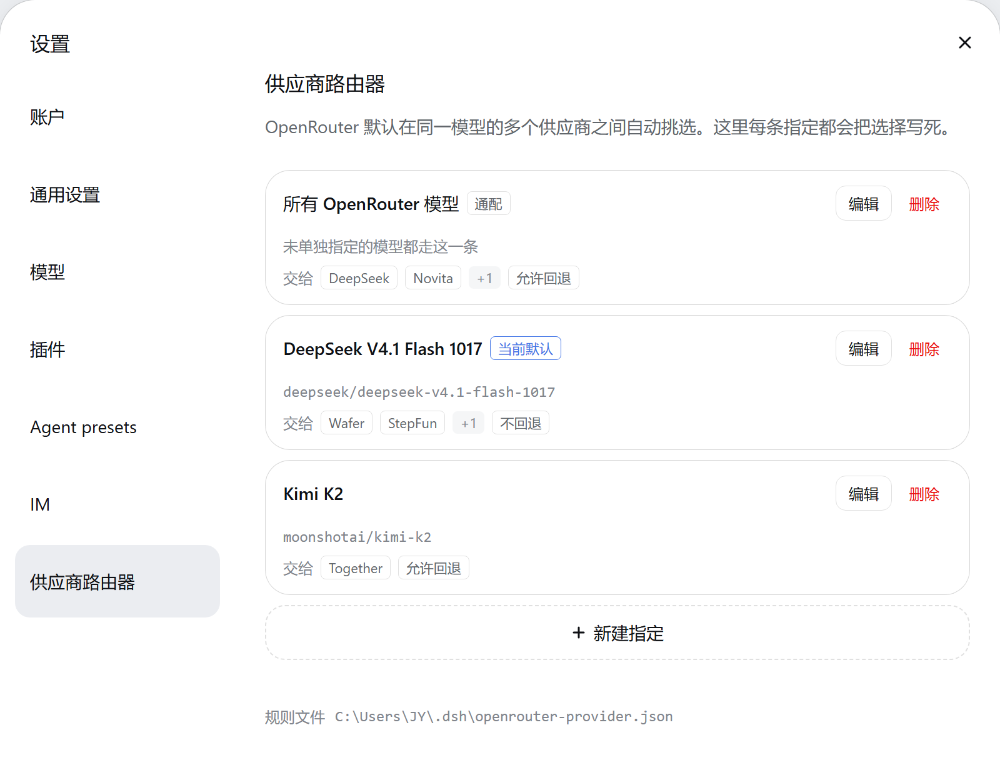
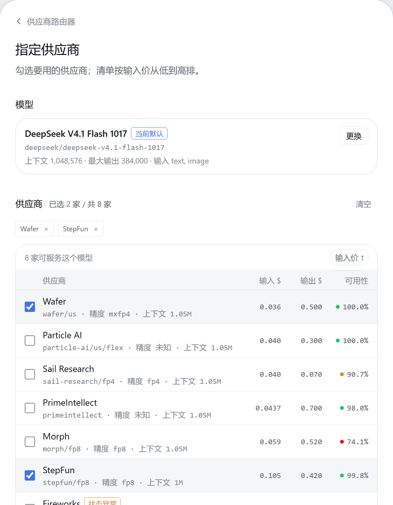
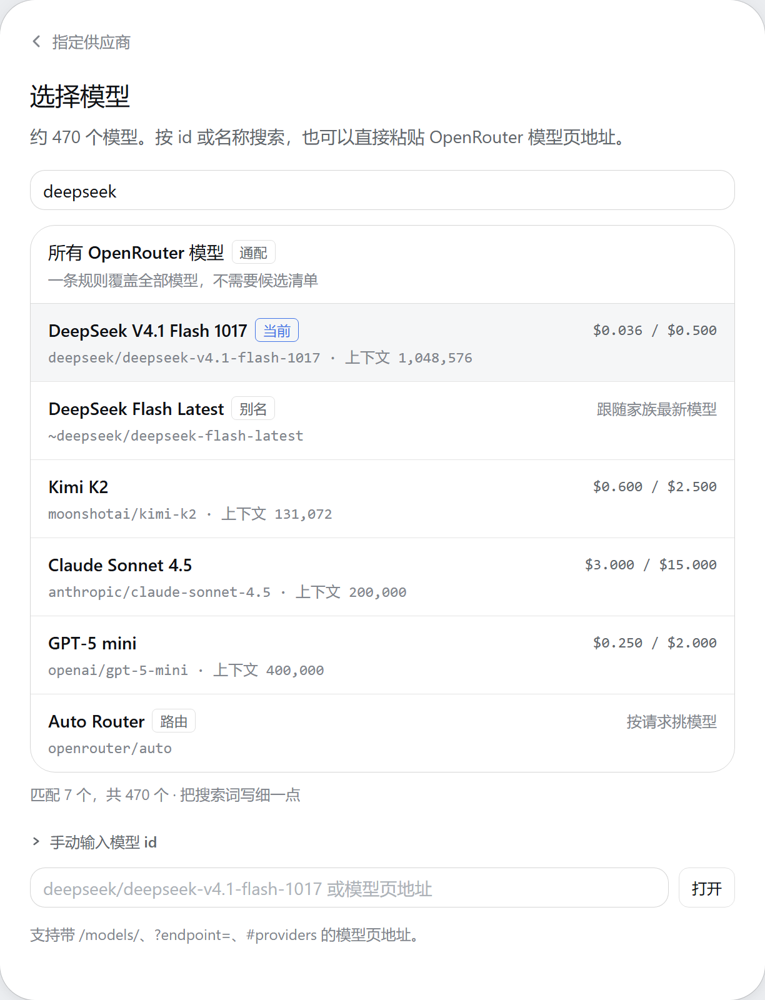

# Provider router (DSH-OpenRouter-Provider)

[中文](README.md) · [English](README.en.md)

A DeepSeek Harness plugin: pin a given OpenRouter model to the upstream providers you choose, from a dedicated Settings page.

OpenRouter picks among a model's providers on its own, fallbacks included. For the same model those providers differ widely in price, quantization, context and uptime — this plugin pins that choice and sends it as `provider.only` and `allow_fallbacks` in the request body.

**Install**: published on npm — open **Plugins → Add plugin** and enter the package name `@creekmoon/dsh-openrouter-provider-router`.

## What it does

- **One rule per model**: a rule covers one model (or "all OpenRouter models"); the list page shows who handles each rule and whether fallbacks are allowed.
- **Pick providers like products**: the table sorts by input price and puts input/output price ($/1M), quantization, context and uptime (dot plus percentage) on the same row; tick a row to add it.
- **Works without a candidate list**: `~` aliases, router models such as `openrouter/auto`, and the wildcard rule have no fixed provider list, so you type slugs below the table instead.

## What it does not do

- It rewrites only `POST /api/v1/chat/completions` requests that this DSH instance sends to `openrouter.ai`; other hosts and routes pass through untouched.
- It handles requests whose body is a JSON string. It does not proxy, forward, retry, or read your OpenRouter balance.
- It does not check that a slug serves the model: a provider that does not serve it returns a 4xx from OpenRouter.

## Install

Requires DSH 0.2.x (verified on 0.2.2-rc.3) plus a configured OpenRouter channel and API key.

### Recommended: install from npm

The package is published on npm as `@creekmoon/dsh-openrouter-provider-router`.

1. Open the **Plugins** page in the sidebar and click **Add plugin**.
2. Enter the package name `@creekmoon/dsh-openrouter-provider-router` in the package field and confirm.
3. Reopen Settings: **Provider router** shows up in the left navigation.

An agent can install it too: call `plugin_manager` with `install_bundle` and the package name as `target`.

### Alternative: install from source (when you want to change the code)

```bash
git clone https://github.com/creekmoon/dsh-openrouter-provider-router.git
```

Gitee mirror: `https://gitee.com/creekmoon/dsh-openrouter-provider-router.git`; the steps are the same. Pick that local directory in **Add plugin** — a local directory is a linked install, so disable and re-enable the plugin after you change the code. If an agent installs it this way, set `target` to that directory's absolute path.

## Using it

Open **Settings → Provider router** to see the pins already saved; click **New pin** at the end of the list, or **Edit** on a row.



The editor confirms the model first, then you tick providers in the table. Ticked rows get a light fill, and the chosen providers sit above the table as removable tags.



When changing the model, the first row is "All OpenRouter models" (a wildcard covering every model); you can also search by name or id, or paste an OpenRouter model page URL.



Saving takes effect immediately; no DSH restart.

## Interface language

The UI follows **Settings → General → Language** and switches immediately, with no reload. The plugin ships complete Simplified Chinese and English copy (`zh` / `en` dictionaries in `client.js`, with identical key sets; a test fails when a key exists on only one side).

The title and description shown in the plugin list come from `locale/zh.json` and `locale/en.json`; other DSH built-in languages such as Japanese and Spanish fall back to English. Rule file contents, logs, and slugs inside error messages stay as they are.

## Where rules live

`$DSH_HOME/openrouter-provider.json`, usually `C:\Users\<you>\.dsh\openrouter-provider.json` on Windows; the list page also prints the real path.

```json
{
  "version": 1,
  "rules": {
    "deepseek/deepseek-v4.1-flash-1017": { "only": ["stepfun/fp8"], "allowFallbacks": false },
    "*": { "only": ["deepseek", "novita/fp8"], "allowFallbacks": true }
  }
}
```

- Keys are model ids; `*` means every OpenRouter model, and a model-specific pin wins over `*`.
- `only` is the provider allowlist; `allowFallbacks` maps to `provider.allow_fallbacks` in the request body.
- Editing the file by hand works too; the page reads the latest content the next time it opens.

## When it does not take effect

- **The default model is an alias**: rules match the request's `model` exactly (only the `~` prefix is ignored). If the session default is `~deepseek/deepseek-flash-latest` and you pinned a concrete model, the rule never matches; the status line on the list page says so after saving.
- **The request does not go through OpenRouter**: DeepSeek official, Kimi and other channels are untouched.
- **A 4xx comes back**: that slug does not serve this model; return to the editor and pick a provider you can tick in the table.

Installed but no "Provider router" in Settings? Close Settings and open it again; if it is still missing, reload the page (Ctrl+R), then check **Settings → Plugins** for a failed sync and hit retry.

## How it works

The Host half `index.js` wraps `globalThis.fetch` in-process: only matching OpenRouter requests get `provider.only` / `provider.allow_fallbacks` merged in; everything else passes through. The browser half `client.js` registers one `settings.section`, and the two halves read and write state through DSH's authenticated channel `POST /api/openrouter-provider`.

The provider list comes from `GET /api/v1/models/<id>/endpoints` (cached for 60 seconds) and the model catalog from `GET /api/v1/models` (cached for 10 minutes); when an endpoint is unavailable the plugin scrapes the model page HTML as a fallback. Sizes and colors follow the official DSH settings page tokens and specs.

No build step: disable and re-enable the plugin after editing. Before changing code, read `AGENTS.md` and `rules/通用开发规范_rule.md`; the Chinese and English READMEs always change in the same round.

```bash
node test/run.mjs              # 5 offline checks
node test/verify-catalog.mjs   # optional: hit the live API and page parsing
```

| Check | Covers |
|---|---|
| `test/verify-host.mjs` | fetch injection, regional hosts, non-OpenRouter hosts, non-JSON bodies, RPC read/write and persistence, unload restore |
| `test/audit-client.mjs` | every locale key resolves both ways, no Chinese copy outside the dictionaries, complete bilingual metadata, module id equals package name, official size gates |
| `test/check-layout.mjs` | usable pixel widths across the 564px content column and the narrow breakpoint |
| `test/render-smoke.mjs` | the three views render without throwing in 17 scenarios, plus structure and copy assertions |
| `test/check-docs.mjs` | the two READMEs link to each other, screenshot paths exist, tags match the `package.json` keywords, and every rule file AGENTS.md routes to exists |

Designs live in `designs/provider-router-redesign/` (canvas, 7 artboards: list, empty, picker, editor, alias, narrow, no catalog).

## Releasing

Bump the version in `package.json`, tag it, push the tag:

```bash
git tag v1.1.0
git push --tags
```

`.github/workflows/publish.yml` runs the offline checks, verifies the tag matches the version, then publishes to npm through GitHub OIDC trusted publishing — no npm token lives in the repository. It relies on the package's npm settings naming this repository (`creekmoon/dsh-openrouter-provider-router`) and workflow (`publish.yml`) as a trusted publisher.

## Repository tags

GitHub topics: `dsh` `deepseek-harness` `dsh-plugin` `dsh-bundle` `openrouter` `openrouter-provider` `provider-routing` `llm-routing` `settings-ui`. The `keywords` in `package.json` match, so the repository turns up when searching by DSH plugin convention.

## License

MIT, see [LICENSE](LICENSE).
