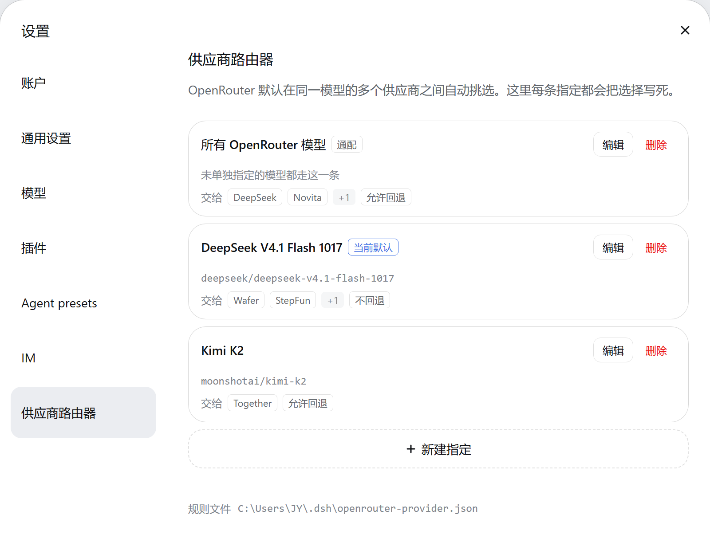
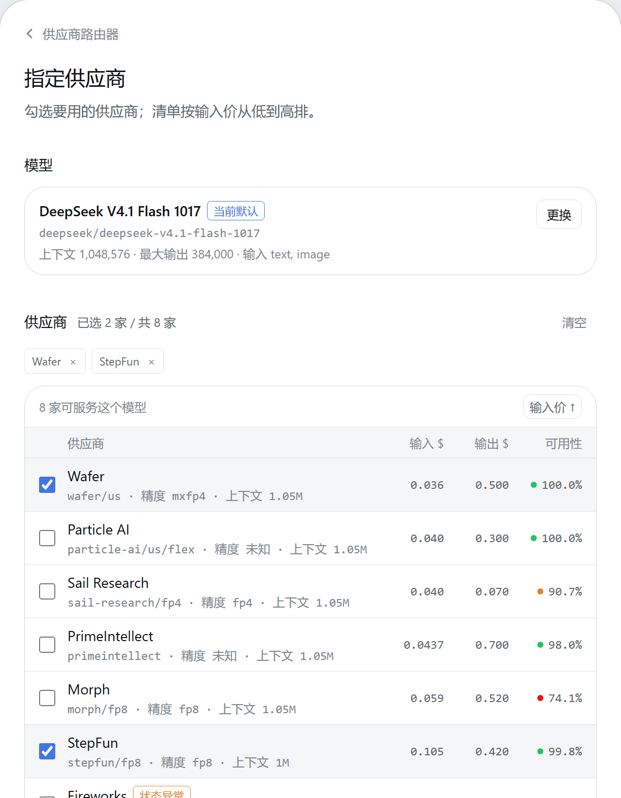
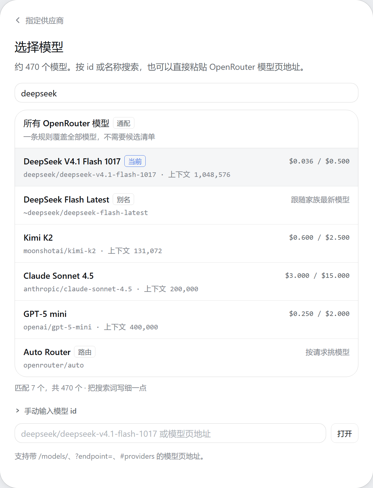

# 供应商路由器（DSH-OpenRouter-Provider）

[中文](README.md) · [English](README.en.md)

给 DeepSeek Harness 用的插件：在设置里把某个 OpenRouter 模型固定到你指定的几家上游供应商。

OpenRouter 默认会在同一模型的多个供应商之间自己挑、自己回退。同一个模型，不同供应商的价格、精度、上下文和可用性差别很大 —— 这个插件把「谁来回这个请求」写死，落成请求体里的 `provider.only` 与 `allow_fallbacks`。

**安装方式**：克隆本仓库，然后在 **设置 → 插件 → 添加插件** 里选中它。

## 它能做什么

- **按模型指定供应商**：一条规则对应一个模型（或「所有 OpenRouter 模型」），清单页一眼看到每条规则交给了谁、是否允许回退。
- **像选商品一样挑供应商**：表格按输入价升序，同一行给出输入/输出单价（$/1M）、精度、上下文、可用性（点色 + 百分比），勾选即加入。
- **没有候选清单也能用**：`~` 别名、`openrouter/auto` 这类路由模型、以及通配规则没有固定供应商清单，直接在表格下方填 slug 即可。

## 它不做什么

- 只改写本机 DSH 发往 `openrouter.ai` 的 `POST /api/v1/chat/completions`；其它域名、其它路由原样放行。
- 只处理 body 是 JSON 字符串的请求；不代理、不转发、不重试，也不读取你的 OpenRouter 余额。
- 不替你验证 slug 是否可用：填了该模型不支持的供应商，请求会被 OpenRouter 返回 4xx。

## 安装

要求 DSH 0.2.x（在 0.2.2-rc.3 上验证），并且已经配好 OpenRouter 渠道与 API Key。

```bash
git clone https://github.com/creekmoon/dsh-openrouter-provider-router.git
```

Gitee 镜像：`https://gitee.com/creekmoon/dsh-openrouter-provider-router.git`，克隆后步骤一样。

1. 打开 **设置 → 插件**，点 **添加插件**（Add plugin），选中克隆下来的目录。
2. 重新打开设置，左侧导航出现 **供应商路由器**。

也可以让 Agent 代装：`plugin_manager` 的 `install_bundle`，`target` 填该目录的绝对路径，包名是 `@creekmoon/dsh-openrouter-provider`。

## 用起来

打开 **设置 → 供应商路由器**，看到的是已经存下来的指定；点末位的 **新建指定**，或某条上的 **编辑**。



编辑页先确认模型，再在供应商表格里勾选。勾选的行浅底高亮，已选的供应商会以可移除的标签排在表格上方。



换模型时第一项是「所有 OpenRouter 模型」（通配，覆盖全部模型），也可以搜索名称/id，或直接粘贴 OpenRouter 模型页地址。



保存后立即生效，不需要重启 DSH。

## 界面语言

界面跟随 **设置 → 通用 → 语言** 即时切换，不用重载页面。插件自带简体中文与英文两套完整文案（`client.js` 的 `zh` / `en` 字典，键一一对应，测试会拦住只写一侧的键）。

插件清单里显示的标题与描述来自 `locale/zh.json` 与 `locale/en.json`；日语、西语等其它 DSH 内置语言回退到英文。规则文件内容、日志和报错里的 slug 保持原样，不翻译。

## 规则存在哪

`$DSH_HOME/openrouter-provider.json`，Windows 下通常是 `C:\Users\<你>\.dsh\openrouter-provider.json`；清单页底部也会显示实际路径。

```json
{
  "version": 1,
  "rules": {
    "deepseek/deepseek-v4.1-flash-1017": { "only": ["stepfun/fp8"], "allowFallbacks": false },
    "*": { "only": ["deepseek", "novita/fp8"], "allowFallbacks": true }
  }
}
```

- 键是模型 id，`*` 表示所有 OpenRouter 模型；单独指定的模型优先于 `*`。
- `only` 是供应商白名单，`allowFallbacks` 对应请求体里的 `provider.allow_fallbacks`。
- 手改这个文件也可以，页面下次打开会读到最新内容。

## 不生效时先看这三条

- **默认模型是别名**：规则按请求里的 `model` 精确匹配（只忽略 `~` 前缀）。会话默认模型是 `~deepseek/deepseek-flash-latest`、而你把规则挂在具体模型上，就不会命中；保存后清单页状态行会明确提示这一点。
- **请求没走 OpenRouter**：DeepSeek 官方、Kimi 等其它渠道不受影响。
- **返回 4xx**：这个 slug 不服务该模型，回到编辑页换成表格里勾得到的供应商。

装完设置里没有出现「供应商路由器」？先关掉设置重新打开；仍然是空的就整页刷新（Ctrl+R），再到 **设置 → 插件** 的插件列表看有没有同步失败，点重试。

## 怎么实现的

Host 半 `index.js` 在进程内包了一层 `globalThis.fetch`：只有命中规则的 OpenRouter 请求才会被合并进 `provider.only` / `provider.allow_fallbacks`，其余原样放行。浏览器半 `client.js` 注册一个 `settings.section`，两半通过 DSH 的认证通道 `POST /api/openrouter-provider` 读写状态。

供应商清单来自 `GET /api/v1/models/<id>/endpoints`（缓存 60 秒），模型目录来自 `GET /api/v1/models`（缓存 10 分钟）；接口不可用时抓模型页 HTML 兜底。界面尺寸与配色沿用 DSH 官方设置页的令牌与规格。

无构建步骤，改完在插件列表里禁用再启用即可。

```bash
node test/run.mjs              # 5 个离线检查
node test/verify-catalog.mjs   # 可选：联网核对真实接口与页面解析
```

| 检查 | 覆盖内容 |
|---|---|
| `test/verify-host.mjs` | fetch 注入、区域域名、非 OpenRouter 主机、非 JSON body、RPC 读写与落盘、卸载还原 |
| `test/audit-client.mjs` | 中英双语键全解析、字典外无中文文案、元数据双语齐全、模块 id 与包名一致、官方尺寸闸门 |
| `test/check-layout.mjs` | 564px 内容列下表格列宽与窄宽断点的可用像素 |
| `test/render-smoke.mjs` | 17 个状态下三视图不抛错，结构与文案断言 |
| `test/check-docs.mjs` | 中英双份 README 互链、截图路径、标签词与 `package.json` 关键词一致 |

设计稿在 `designs/provider-router-redesign/`（画布，7 块画板：清单、空态、选模型、编辑、别名、窄宽、无清单状态）。

## 仓库标签

GitHub topics：`dsh` `deepseek-harness` `dsh-plugin` `dsh-bundle` `openrouter` `openrouter-provider` `provider-routing` `llm-routing` `settings-ui`。`package.json` 的 `keywords` 与之一致，按 DSH 插件规范检索时能搜到本仓库。

## 许可

MIT，见 [LICENSE](LICENSE)。
